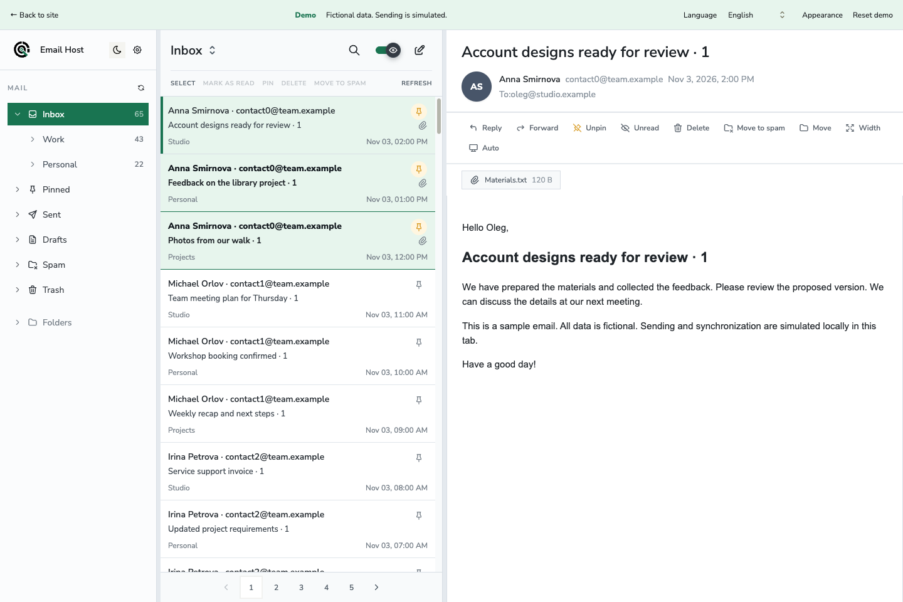
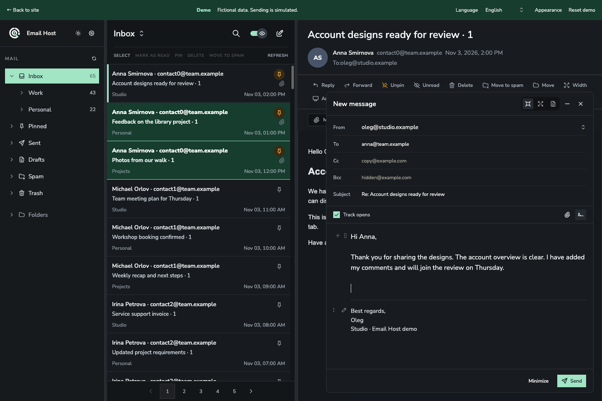

# Email Host

Your existing mailboxes in one web app. Run Email Host on your server, connect IMAP/SMTP accounts, and read, search, and send mail from a browser or PWA.

[Try the demo](https://emailhost.olegsan.tech/demo/?lang=en) · [Install](docs/public/installation.en.md) · [По-русски](docs/public/README.ru.md) · [FAQ](docs/public/faq.md) · [Contribute](CONTRIBUTING.md)



_Screenshots show the real interface with fictional demo data. Sending and synchronization are simulated in the demo._

## What you can do

- Read multiple mailboxes in one list, or switch between accounts and account profiles.
- Search mail, write messages, use signatures, and manage folders and message flags.
- Use Russian or English, light or dark themes, and your own accent color.
- Install the web app as a PWA. Previously downloaded mail can remain available offline in that browser.
- Invite separate users to your installation. Each user connects their own mailboxes.

Email Host is a mail client. It connects accounts you already have with a mail provider; it does not create new public email addresses or replace your provider's SMTP/IMAP server.

## Install on your server

The current stable application release is **`0.1.0`**. Read the [installation requirements and verification scope](docs/public/installation.en.md) before deploying. Backup restoration and application upgrades do not yet have a verified end-to-end procedure.

Prepare a Linux server and three DNS names pointing to it, for example:

| Purpose             | Example                        |
| ------------------- | ------------------------------ |
| Application         | `mail.example.com`             |
| Convex backend      | `convex.mail.example.com`      |
| Convex HTTP actions | `convex-site.mail.example.com` |

On an empty server:

```sh
curl -fsSL https://emailhost.olegsan.tech/install/service-standalone | sudo bash
```

For an existing proxy, choose the corresponding command:

```sh
# Existing Docker Traefik
curl -fsSL https://emailhost.olegsan.tech/install/service-traefik | sudo bash

# Nginx running on the host
curl -fsSL https://emailhost.olegsan.tech/install/service-nginx | sudo bash
```

The wizard asks for domains, shows its plan, and generates the owner login and secrets. It downloads ready images from the project website; you do not build the application on your server. The Nginx mode prepares a new configuration for you to review and connect to your existing HTTPS setup. Existing Traefik settings may need confirmation.

These commands execute downloaded code with administrator privileges. You can download and read the entry script and [the common installer](deploy/public/install.sh) before running them. See the [installation guide](docs/public/installation.en.md) for DNS, ports, credentials, retries, and the boundaries of each proxy mode.

## See the interface

The [public demo](https://emailhost.olegsan.tech/demo/?lang=en) needs no account. Its mail, addresses, and attachments are fictional. It cannot send real mail or connect a real mailbox.



The [Russian overview](docs/public/README.ru.md) also shows the mobile layout. [Screenshot sources](docs/images/README.md) describe how these images were captured.

## For contributors and coding agents

The demo is the quickest way to run the interface locally without a backend:

```sh
bun install --frozen-lockfile
bun run --cwd apps/site dev
```

Open `http://127.0.0.1:4176/demo/?lang=en`.

- [Contributing](CONTRIBUTING.md) covers setup, checks, and pull requests.
- [Architecture](docs/public/architecture.md) maps the applications, shared packages, runtime, and data flow.
- [AGENTS.md](AGENTS.md) gives coding agents the project rules and starting points.
- [Glossary](glossary.md) defines the terms used in the UI and code.
- [Security](SECURITY.md) explains how to report vulnerabilities privately.

## License

Email Host's original code is under the [MIT License](LICENSE). Third-party components keep their own terms. The separately distributed Convex backend uses FSL-1.1-Apache-2.0; the complete container distribution is not covered solely by MIT. Read the [third-party notices](THIRD_PARTY_NOTICES.md).
