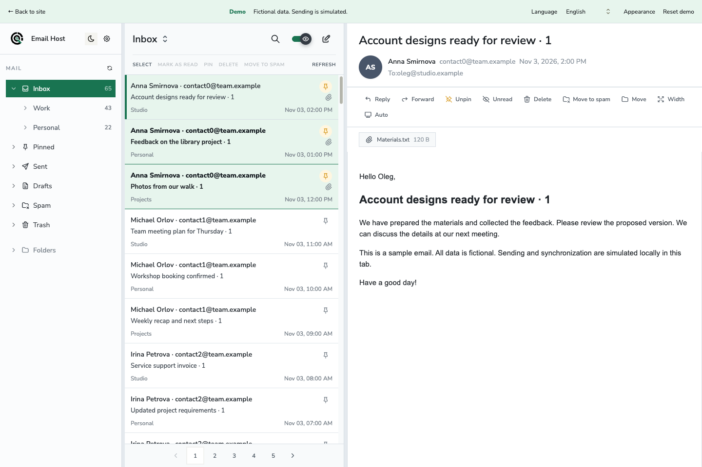
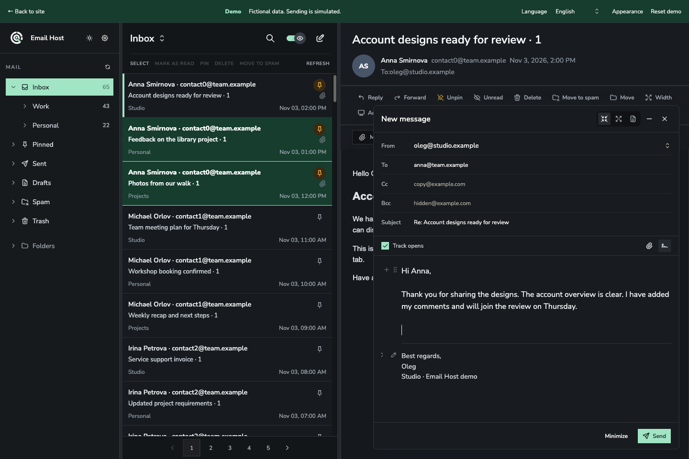
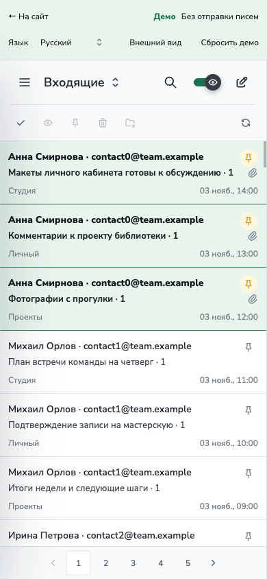

# Screenshots

The Email Host interface on desktop and mobile. All messages and addresses are fictional demo data. Click an image to view it at full size, or [try the demo](https://emailhost.olegsan.tech/demo/?lang=en).

## Inbox · light theme

Mailboxes in one list, with a message open alongside it.

## Compose · dark theme

Writing a message in the dark theme. The demo simulates sending.

## Mobile · Russian interface

The inbox on a narrow screen.

Capture details and reproduction

Captured from the running demo on 11 November 2026. Desktop views use a 1440 × 960 CSS viewport; the mobile view uses 390 × 844. These are screenshots of the application, without generated or composited interface elements. No real mailbox or credentials are shown.

Run `bun run --cwd apps/site dev`, then open `/demo/?lang=en` or `/demo/?lang=ru`. Choose the theme and language in the demo controls. Wait for layout transitions to finish before capturing a mobile view.

The screenshots are documentation assets under the repository's [MIT license](../../LICENSE). Third-party software retains its own licenses.

