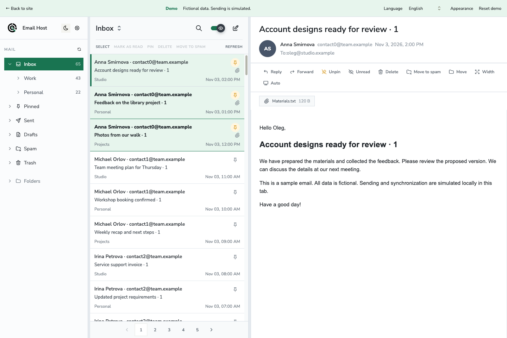
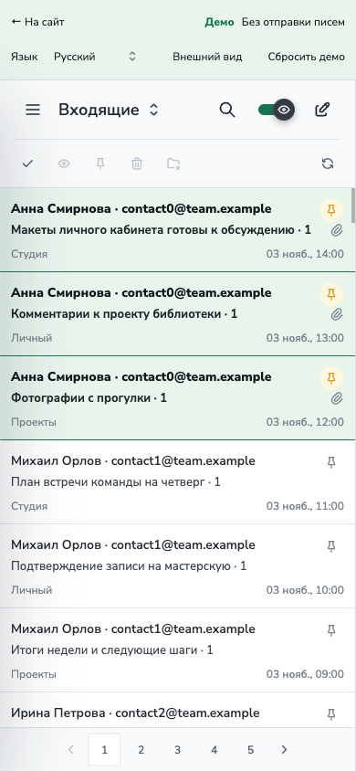

# Email Host

Все существующие почтовые ящики в одном веб-приложении. Установите Email Host на своём сервере, подключите IMAP/SMTP-аккаунты и читайте, ищите и отправляйте письма через браузер или PWA.

[Открыть демо](https://emailhost.olegsan.tech/demo/?lang=ru) · [Установка](../installation.md) · [English](../../README.md) · [Вопросы и ответы](faq.md)



На снимках настоящий интерфейс с вымышленными данными. Демо имитирует отправку и синхронизацию в браузере.

## Возможности

- Несколько ящиков, общий список писем и профили для группировки аккаунтов.
- Поиск, редактор писем, подписи, папки и управление состоянием писем.
- Русский и английский языки, светлая и тёмная темы, настраиваемый акцентный цвет.
- Веб-приложение и PWA. Офлайн доступны письма, которые этот браузер уже сохранил.
- Отдельные пользователи по приглашению владельца. Каждый подключает свои ящики.

Email Host подключается к существующему почтовому провайдеру. Приложение не выдаёт новые публичные email-адреса и не заменяет его SMTP/IMAP-сервер.

## Установка

Текущий стабильный выпуск приложения: **`0.1.0`**. Перед установкой изучите [проверенные условия и ограничения](../installation.md). Полный порядок восстановления резервных копий и обновления приложения пока не подтверждён сквозной проверкой.

Подготовьте Linux-сервер и три DNS-имени, которые указывают на него: `mail.example.com`, `convex.mail.example.com` и `convex-site.mail.example.com`. Мастер предлагает два служебных имени по основному домену.

Для пустого сервера:

```sh
curl -fsSL https://emailhost.olegsan.tech/install/service-standalone | sudo bash
```

Для существующего Docker Traefik:

```sh
curl -fsSL https://emailhost.olegsan.tech/install/service-traefik | sudo bash
```

Для Nginx на хосте:

```sh
curl -fsSL https://emailhost.olegsan.tech/install/service-nginx | sudo bash
```

Мастер спросит домены, покажет план и сгенерирует ключи и вход владельца. Приложение не нужно собирать на сервере, готовые образы скачиваются с сайта проекта. Для Traefik может потребоваться подтвердить существующие настройки. Для Nginx мастер готовит отдельный конфиг, который нужно проверить и подключить к своей настройке HTTPS.

Скачанный код выполняется с правами администратора. До запуска можно прочитать [общий установщик](../../deploy/public/install.sh). Подробности о DNS, портах, доступе и повторном запуске находятся в [инструкции установки](../installation.md).

## На телефоне

<p></p>

Отдельное нативное приложение для просмотра этого интерфейса не требуется. Возможности установки PWA и уведомлений зависят от браузера и HTTPS.

## Разработка и сопровождение

[CONTRIBUTING.md](../../CONTRIBUTING.md) описывает локальный запуск демо без backend, проверки и подготовку изменений. [Карта архитектуры](architecture.md) показывает, где находятся компоненты, а [AGENTS.md](../../AGENTS.md) и [словарь](../../glossary.md) помогают агентам ориентироваться в проекте.

Об уязвимостях сообщайте через [приватный канал](../../SECURITY.md). Не публикуйте настоящие письма, пароли или ключи в issues.

## Лицензии

Собственный код Email Host опубликован под [MIT](../../LICENSE). Сторонние компоненты сохраняют свои лицензии. Отдельно поставляемый Convex backend использует FSL-1.1-Apache-2.0, поэтому весь контейнерный комплект не покрывается только MIT. Условия перечислены в [THIRD_PARTY_NOTICES.md](../../THIRD_PARTY_NOTICES.md).
