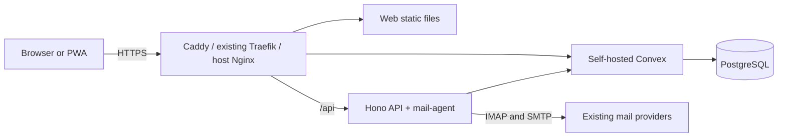

# Architecture and code map

Email Host is a Bun/TypeScript monorepo. React and Vite build the browser applications. A Hono API runs the mail services, while a self-hosted Convex backend provides application data and reactive browser queries. PostgreSQL persists the backend's data.

## Packages

| Path                              | Responsibility                                                                                     | Start here when changing                  |
| --------------------------------- | -------------------------------------------------------------------------------------------------- | ----------------------------------------- |
| `apps/web`                        | Real mail application, routing, controllers, API/Convex clients, offline state and PWA integration | Mail behavior or browser data flow        |
| `apps/site`                       | Bilingual website and fictional demo, using the real mail interface with isolated adapters         | Website, demo examples or demo boundaries |
| `apps/api`                        | Hono server entry point, owner seeding and service lifecycle                                       | API process startup                       |
| `packages/mail-agent`             | Authentication, HTTP routes, mail synchronization, provider connections and sending                | Backend operations or IMAP/SMTP           |
| `packages/mail-design`            | Shared mail views, compose and settings presentation, locale and theme                             | Mail UI and design behavior               |
| `packages/ui`                     | Shared interface components                                                                        | Controls used across applications         |
| `packages/editor-ui`              | Rich text editor and its commands                                                                  | Message editing                           |
| `packages/pwa`                    | Shared PWA and notification support                                                                | Browser app updates and push integration  |
| `convex`                          | Schema, public queries and server-only operations                                                  | Data contracts and reactive access        |
| `deploy/public`                   | Compose variants, configuration bootstrap, runtime entrypoints and installer                       | New self-hosted installation              |
| `scripts/build-public-release.sh` | Builds a versioned static installation tree and image bundles locally                              | Release artifact preparation              |

Read each package's `package.json` for the current commands, dependencies and exports. Avoid copying presentation components into a second implementation.

## Runtime

The API handles login and server-side operations. The browser obtains a Convex JWT from the API and uses authenticated Convex queries, including reactive connections. Administrative Convex keys and provider credentials belong on the server and must not enter a browser bundle.

The public web image receives its Convex address at startup through `runtime-config.js`. A development Vite build can use `VITE_CONVEX_URL`. See `apps/web/src/lib/public-runtime-config.ts` and `apps/web/src/lib/convex.tsx` before changing that boundary. Do not hardcode a maintainer's backend address.

Mail workers and provider credentials are implemented in `packages/mail-agent`. Data/schema changes belong in `convex`. Read both sides of a contract before editing either one. Applying a schema change to a live instance is a separate operator action.

## Demo boundary

`apps/site` uses the real mail UI and local fictional data. Its Vite aliases replace API transport, Convex integration and PWA behavior for that build. Sending and connection setup are simulated. The demo's mail storage uses its own namespace; theme and accent are shared on the same browser origin.

Keep these adapters isolated from `apps/web`. A screenshot or a passing demo interaction proves the presentation scenario, not IMAP delivery, authorization or durable backend storage. See [the site README](../../apps/site/README.md) for details.

## Offline behavior

The web application caches downloaded mail in IndexedDB. Cached list rows and saved message content are different states. Offline availability is limited to this browser's saved data; it is not a complete server backup. Read `apps/web/src/lib/offline-mail-schema.ts`, `offline-mail-query.ts`, and `offline-mail-cache.ts` before changing that path.

## Installation and maintenance

The public installer creates a separate Compose project, generates new secrets, initializes PostgreSQL/Convex, deploys functions, then starts API, web and the selected HTTPS route. Repeating installation preserves configuration and is intended for safe continuation. It is not an application upgrade.

A release contains ready images in architecture-specific Docker-save archives. The server downloads them from the project website, verifies checksums and image identities, and loads them locally. The release builder does not publish files or update a running server.

Start with [installation](../installation.md), [contributor instructions](../../CONTRIBUTING.md) and [agent rules](../../AGENTS.md). Test new deployment, schema and restore work against an isolated instance with synthetic data. Do not use a live user's database as a development fixture.
